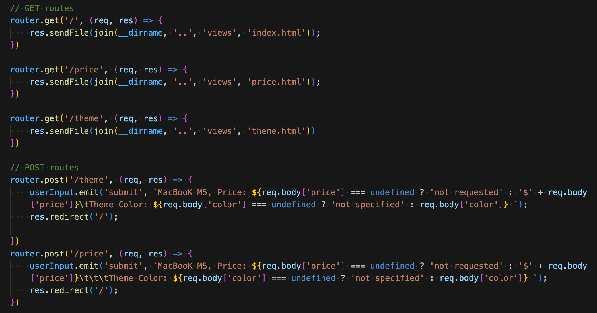
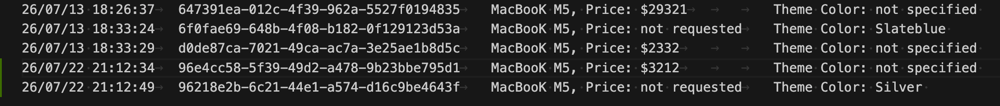

# Log Stuff

A Express-based logger app that records incoming HTTP requests and user-submitted form data to log files.

## Features

- Serves a static UI with three routes:
  - `/` — home page
  - `/price` — price submission page
  - `/theme` — theme/color submission page
- Logs every incoming request to `logs/requestLog.txt`
- Logs form submissions to `logs/inputData.txt` with a timestamp and UUID
- Automatically creates the `logs/` directory if it does not exist
- Supports configuration of the server port with `PORT_ASSIGNMENT`

## Routes



## Logs



## Installation

Install all the dependences (date-fns, express) and devDependencies (nodemon, dotenv)
```bash
npm install
```

Run the scripts 'start' or 'dev' provided
```bash
npm run start 
```

The server will start on `http://localhost:3232` by default, or the port configured in `PORT_ASSIGNMENT`.


## Project Structure

- `server.js` — app entrypoint and Express configuration
- `routes/route.js` — route handlers and event-based input logging
- `middleware/logEvents.js` — request logger and file writer
- `views/` — HTML views for the UI
- `public/` — static assets such as CSS
- `logs/` — generated request and input log files

## Notes

- Logs are appended to `logs/requestLog.txt` and `logs/inputData.txt`.
- If the `logs/` directory does not already exist, it is created automatically.
- The `PORT_ASSIGNMENT` environment variable is loaded via `dotenv/config`.

